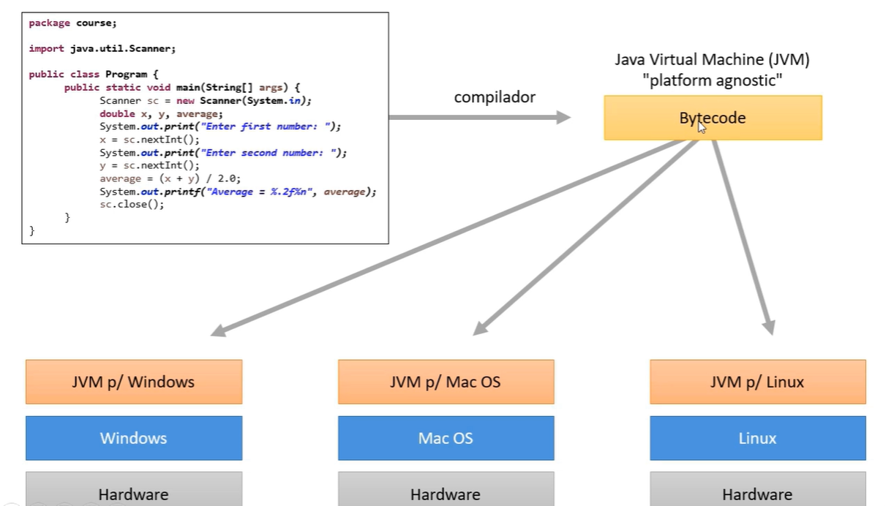
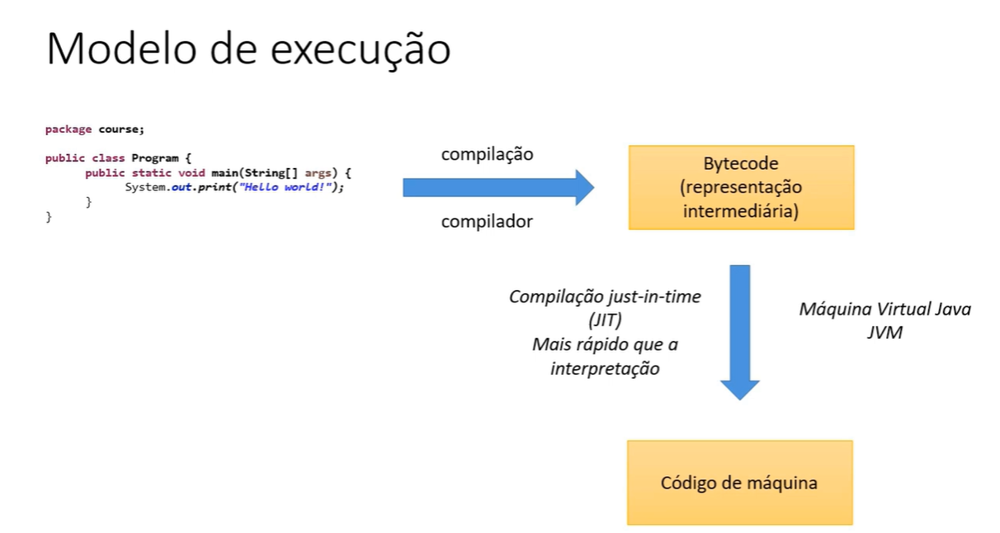

# Java - Contextualização

## O que é Java?

- Linguagem de programação (regras sintáticas);

- Plataforma de desenvolvimento e execução:
    - Bibliotecas (APIs);
    - Ambientes de execução.

## Histórico

- Problemas resolvidos e motivo do sucesso do Java:
    - Ponteiros / gerenciamento de memória;
    - Portabilidade falha: reescrever parte do código ao mudar de SO;
    - Utilização em vários dispositivos;
    - Custo.

- Java foi criado pela empresa *Sun Microsystems* no meio da década de 1990;

- Em 2010 o Java foi adquirido pela *Oracle Corporation*.

## Aspectos notáveis

- Código compilado para bytecode e executado em máquina virtual (JVM);

- Portável, segura e robusta;

- Roda em vários tipos de dispositivos.

## Edições do Java

- Java ME - Java Micro Editon -> Dispositivos móveis e embarcados - IoT
    - https://www.oracle.com/java/technologies/javameoverview.html

- Java SE - Java Standard Edition -> Core - Desktop e Servidores
    - https://www.oracle.com/br/java/technologies/java-se-glance.html

- Java EE - Java Enterprise Edition -> Aplicações corporativas
    - https://www.oracle.com/br/java/technologies/java-ee-glance.html

--- 

# Versões do Java

## Resumo das versões LTS

| Versão      | Ano de Lançamento |
| ----------- | ----------------- |
| **Java 25** | 2025              |
| **Java 21** | 2023              |
| **Java 17** | 2021              |
| **Java 11** | 2018              |
| **Java 8**  | 2014              |

> Versões LTS, são versões que tem um longo período de suporte por vários anos. Enquanto as outras versões são apenas temporárias e para testes.

Abaixo, segue em resumo sobre o que cada versão LTS do Java trouxe de atualização/mudança:

## Java 25

Lançado em 2025.

* Nova LTS com foco em estabilidade
* Continuidade do Project Loom

## Java 21

Lançado em 2023.

* Virtual Threads finalizados
* Sequenced Collections
* Pattern Matching avançado

## Java 17

Lançado em 2021.

* Sealed classes
* Melhorias no garbage collector
* Nova API de Random

## Java 11

Lançado em 2018.

* HTTP Client
* Novos métodos de String e Files
* Remoção de módulos legados

## Java 8

Lançado em 2014.

* Lambdas
* Streams API
* Nova API de data/hora (java.time)

---

# Plataforma Java SE

- **JVM - Java Virtual Machine**
    - Máquina virtual do Java - necessário para executar sistemas Java.

    

    