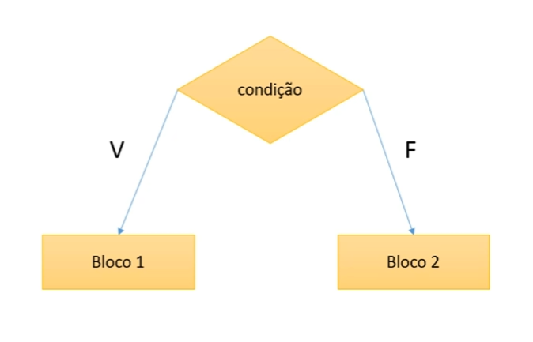

# Estrutura Condicional

É uma estrutura de controle que permite que um certo bloco de comandos somente será executado dependendo de uma condição.



## Sintaxe da estrutura condicional

### Simples

```java
if (<condicao>) {
    <comando1>
    <comando2>
}
```

**Regra:**
- *Verdadeira:* executa o bloco de comandos
- *Falsa:* pula o bloco de comandos

---

### Composta

```java
if (<condicao>) {
    <comando1>
    <comando2>
}
else {
    <comando3>
    <comando4>
}
```

**Regra:**
- *Verdadeira:* executa somente o bloco do `if`
- *Falsa:* executa somente o bloco do `else`

### Encadeamento de estruturas condicionais

```java
if (<condicao1>) {
    <comando1>
    <comando2>
}
else if (<condicao2>) {
    <comando3>
    <comando4>
}
else {
    <comando5>
    <comando6>
}
```